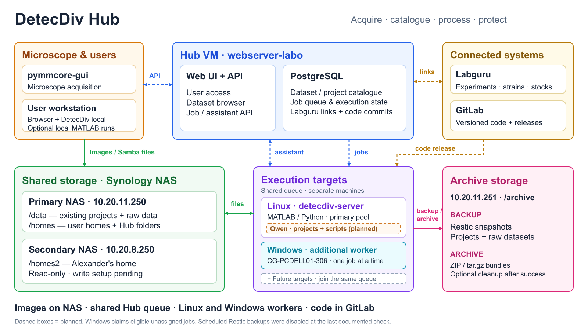

# DetecDiv Hub — landscape overview



[SVG with animation groups](figures/detecdiv-hub-overview-animatable.svg)

The microscope writes images to shared NAS storage. The Hub VM maintains the
dataset catalogue and queues work. Linux workers on `detecdiv-server` run
DetecDiv, indexing, backup and archive tasks; the same machine hosts Qwen.
The additional native Windows worker on `CG-PCDELL01-306` processes one eligible
unassigned job at a time from the same queue. Labguru provides linked experiment
records and reference catalogues. GitLab versions the processing code.

Qwen project and scripting tools are planned. `/homes2` is currently read-only.
The periodic Restic scheduler was disabled at the last documented live check.

## Animation hooks

The SVG is a fixed 1600 × 900 landscape canvas. Text and geometry remain vector
elements. Everything is visible by default, with stable group IDs, separate
groups for arrows and labels, and `data-step` attributes for staged reveals.
Purple identifies the Linux pool, turquoise the additional Windows worker,
and a dashed grey box represents future worker targets.

| Part | SVG group ID |
| --- | --- |
| Acquisition / desktop | `acquisition-client`, `desktop-client` |
| Hub API / catalogue | `hub-api`, `hub-database` |
| External systems | `labguru`, `gitlab` |
| Primary / secondary NAS | `primary-nas`, `secondary-nas` |
| Execution fleet | `execution-targets` |
| Linux host / worker pool | `linux-host`, `linux-workers` |
| Additional Windows worker | `windows-worker` |
| Future targets | `future-workers` |
| Planned AI helper | `qwen-assistant` |
| Protection tasks | `archive-storage`, `backup-task`, `archive-task` |
| Queue / releases | `flow-jobs`, `flow-code-release` |
| File transfers | `flow-client-files`, `flow-worker-files` |
| API / Labguru / assistant | `flow-api`, `flow-labguru`, `flow-assistant` |
| Backup and archive flow | `flow-protection` |

Each flow has a child path named `<group-ID>-path` and separate
`<group-ID>-heads` and `<group-ID>-label` groups. Worker types also have the
classes `linux-target`, `windows-target`, and `future-target`.

For browser or Reveal.js animation, load the SVG inline and select its groups:

```js
const svg = document.querySelector('#hub-diagram');
function showStep(step) {
  for (const group of svg.querySelectorAll('[data-step]')) {
    group.style.transition = 'opacity 300ms ease';
    group.style.opacity = Number(group.dataset.step) <= step ? '1' : '0';
  }
}
// Steps 1–9 are described in the SVG's animation-map metadata.
showStep(5); // Linux execution
showStep(6); // Reveal the additional Windows worker
```

Regenerate the editable SVG with
`node scripts/generate_hub_overview_svg.mjs`. The geometry, IDs, and reveal
sequence are maintained in that source file.
